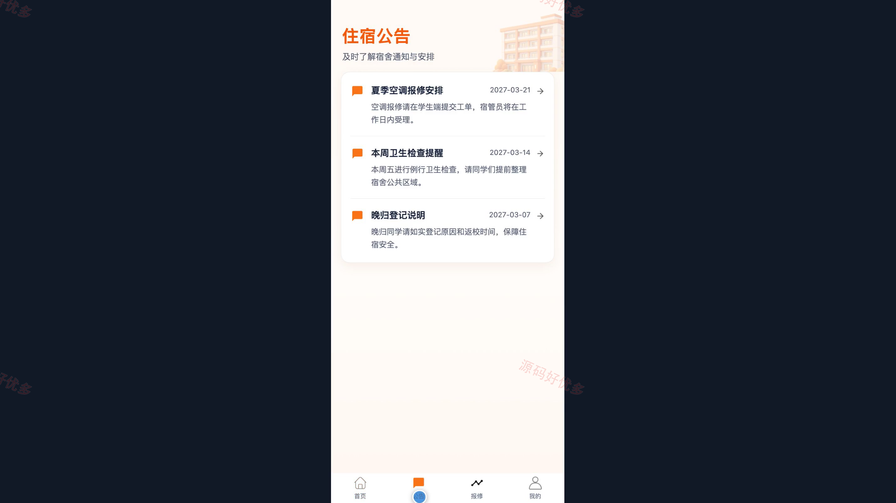
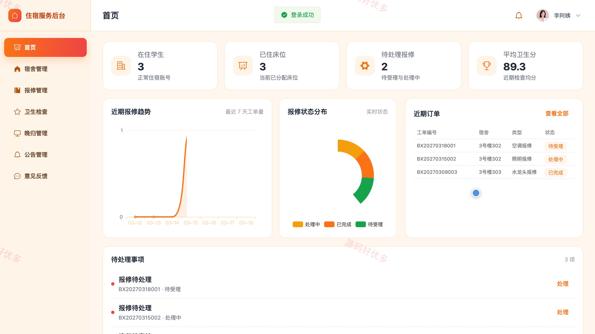
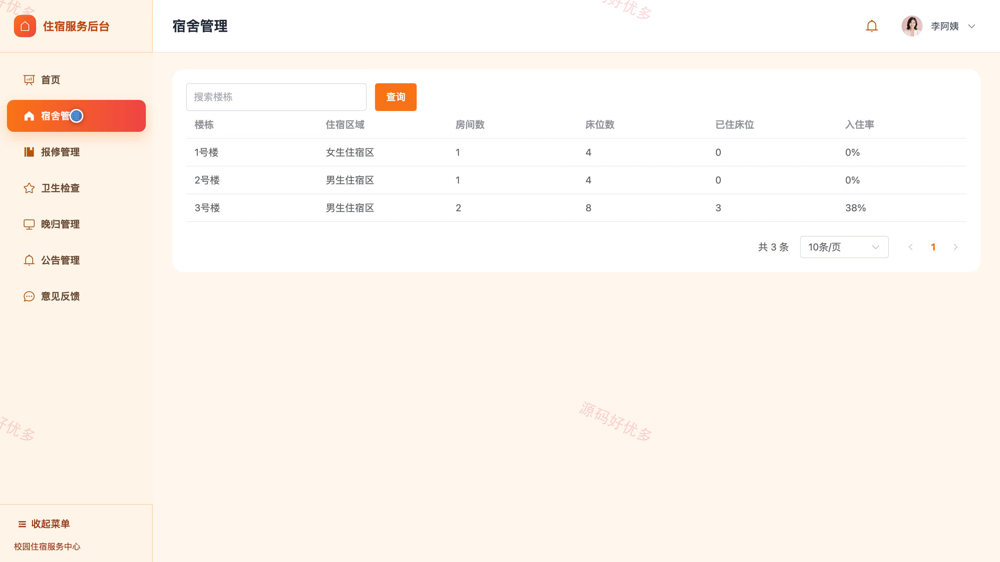
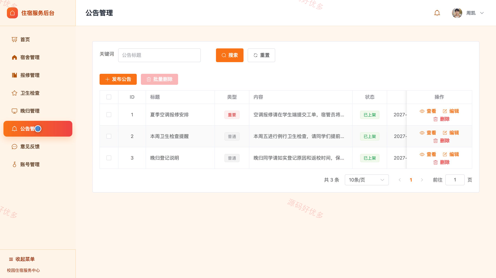

# bs017B
bs017B宿舍报修与服务管理小程序源码 Java SpringBoot3 Vue3 文档 PPT
## 源码问题查看主页咨询

### 一、关键词
宿舍报修、宿舍服务、住宿管理、晚归登记、卫生检查

### 二、作品包含
源码+数据库+万字设计文档+PPT+全套环境和工具资源+本地部署教程

### 三、项目技术
前端技术： Html、Css、Js、Vue3.4、Element-Plus、uniapp
后端技术：Java、SpringBoot3.2.0、MyBatis-Plus

### 四、运行环境要求
开发工具：IDEA/eclipse + VSCODE + HBuilder X + 微信开发者工具

数据库：MySQL5.7+（共11张表）

数据库管理工具：Navicat10以上版本

环境配置软件： JDK17 + Maven3.6

前端Nodejs：20.20.2

浏览器：谷歌浏览器

### 五、项目介绍
项目编号：bs017B

宿舍报修与服务管理小程序面向学生、宿管员和管理员，覆盖住宿公告、在线报修、卫生检查、晚归登记与意见反馈等业务。学生通过小程序提交和查询事项，宿管员在后台处理日常住宿服务，管理员负责账号及整体业务管理。

角色：学生、宿管员、管理员

学生功能：小程序登录与注册、住宿公告浏览、在线报修与进度查询、卫生检查记录查看、晚归登记、意见反馈、个人资料与密码维护。

宿管员功能：后台登录与数据看板、宿舍信息管理、报修工单管理、卫生检查管理、晚归记录管理、公告与意见反馈管理、个人资料维护。

管理员功能：后台登录与数据看板、宿舍信息管理、报修与卫生检查管理、晚归记录管理、公告与意见反馈管理、账号管理、个人资料维护。

### 六、运行截图

